<p align="center">
  
</p>

<p align="center">
  <a href="https://tryhackme.com/p/mrrlovermann1678"></a>
  <a href="https://t.me/Toek_sopanha"></a>
  <a href="https://www.facebook.com/share/1CVf9TKRt8/?mibextid=wwXIfr"></a>
  <a href="https://www.reddit.com/user/ArmadilloFancy2418/"></a>
  
</p>

<p align="center">
  
</p>

### `> whoami`

```text
name      : Toek Sopanha
location  : Cambodia
role      : IT Support Specialist [ 1+ yr ]  ->  aspiring Red Teamer
education : 3rd-year university student
focus     : offensive security · penetration testing · red teaming
scope     : labs, CTFs & authorized targets only
motto     : think like an attacker. defend like an engineer.
```

### `> cat methodology.txt`

<p align="center">
  
</p>

### `> ls ~/arsenal`

<p align="center">
  
</p>

### `> cat roadmap.txt`

```text
[x] foundation   it support · app support · windows/linux · active directory
[x] network      tcp/ip · subnetting · cisco · vlan · dns       (cisco networking basics ✓)
[~] ops          bash/powershell · docker · ci/cd · cloud basics
[~] blue         siem · log analysis · alert triage             <- know the defender
[>] red          recon · web exploitation · privesc · AD attacks <- current mission
[ ] certs        eJPT -> PenTest+ -> OSCP -> CRTO
```

### `> ls ~/certs`

<p align="center">
  <a href="image/Networking%20Basic.pdf"></a>
  
</p>

### `> thm --profile`

<p align="center">
  <a href="https://tryhackme.com/p/mrrlovermann1678"></a>
</p>

```text
[~] pre-security             fundamentals     in progress
[~] jr-penetration-tester    red team         in progress
[ ] web-app-pentesting       red team         queued
[ ] red-teaming              red team         queued
[ ] offensive-pentesting     red team         queued
[ ] soc-level-1              blue team        queued   <- know the defender
```

### `> stats`

<p align="center">
  
  
</p>

<p align="center">
  
</p>

<p align="center">
  
</p>
