<p align="center">
  
</p>

<p align="center">
  <a href="https://www.facebook.com/share/1CVf9TKRt8/?mibextid=wwXIfr"></a>
  <a href="https://t.me/Toek_sopanha"></a>
  <a href="https://www.reddit.com/user/ArmadilloFancy2418/"></a>
  <a href="https://tryhackme.com/p/ToekSopanha"></a>
  
</p>

<p align="center">
  
</p>

### `> whoami`

```text
name      : Toek Sopanha
location  : Cambodia
role      : IT Support Specialist  [ 1+ year ]
education : 3rd-year university student
mission   : keep systems up. keep attackers out.
```

### `> cat roadmap.txt`

```text
[SUPPORT]  hardware · windows/linux admin · active directory · ticketing · app support & log triage
[DEVOPS ]  linux · bash/powershell · docker · ci/cd (github actions) · aws basics · monitoring
[NETWORK]  tcp/ip · subnetting · cisco routing & switching · vlan · dhcp · dns · nat · vpn
[BLUE   ]  siem · log analysis · alert triage · incident response          <- SOC
[RED    ]  recon · enumeration · web exploitation · privilege escalation   <- PENTEST
```

### `> ls ~/stack`

<p align="center">
  
</p>

### `> ls ~/certs`

<p align="center">
  <a href="image/Networking%20Basic.pdf"></a>
  
</p>

### `> thm --profile`

<p align="center">
  <a href="https://tryhackme.com/p/ToekSopanha">
    
  </a>
</p>

```text
[~] pre-security             fundamentals        in progress
[~] soc-level-1              blue team           in progress
[ ] jr-penetration-tester    red team            queued
[ ] devsecops                devops + security   queued
```

### `> stats`

<p align="center">
  
  
</p>

<p align="center">
  
</p>

<p align="center">
  
</p>
