<!-- ===================== HEADER ===================== -->
<p align="center">
  
</p>

<p align="center">
  <a href="https://github.com/ToekSopanha">
    
  </a>
</p>

<p align="center">
  <a href="https://www.facebook.com/share/1CVf9TKRt8/?mibextid=wwXIfr"></a>
  <a href="https://t.me/Toek_sopanha"></a>
  <a href="https://www.reddit.com/user/ArmadilloFancy2418/"></a>
  <a href="https://tryhackme.com/p/ToekSopanha"></a>
  
</p>

<!-- ===================== TERMINAL ===================== -->
<p align="center">
  
</p>

<!-- ===================== ABOUT ===================== -->
##  About Me

```yaml
name:      Toek Sopanha
location:  Cambodia 🇰🇭
role:      IT Support Specialist  (1+ year experience)
education: 3rd-year University Student
focus:
  - IT Support & Application Support
  - DevOps (CI/CD, Docker, Linux, Cloud)
  - Networking (Cisco, TCP/IP, routing & switching)
  - Cybersecurity — Blue Team (SOC) & Red Team (Pentest)
learning:  TryHackMe 🚩 — SOC Level 1 · Jr Penetration Tester · Pre Security
motto:     "Keep systems up, keep attackers out."
```

<!-- ===================== ROADMAP ===================== -->
## 🧭 My Path

<table>
<tr>
<td width="50%" valign="top">

### 🛠️ IT & Application Support
- 🔧 Hardware troubleshooting & maintenance
- 💻 Windows & Linux administration
- 👥 Active Directory, users & permissions
- 🎫 Ticketing, incident & problem management
- 🧩 App deployment, log analysis & bug triage
- 🖨️ Printers, peripherals & mobile devices

</td>
<td width="50%" valign="top">

### ⚙️ DevOps
- 🐧 Linux & Bash / PowerShell scripting
- 🐳 Docker & container basics
- 🔁 CI/CD with GitHub Actions
- ☁️ Cloud fundamentals (AWS)
- 📈 Monitoring & logging
- 🌱 Infrastructure as Code *(learning)*

</td>
</tr>
<tr>
<td width="50%" valign="top">

### 🌐 Networking
- 📡 TCP/IP, OSI model, subnetting
- 🔀 Routing & switching (Cisco)
- 🧱 VLANs, DHCP, DNS, NAT
- 🔥 Firewalls & VPN basics
- 🦈 Packet analysis with Wireshark

</td>
<td width="50%" valign="top">

### 🛡️ Cybersecurity — SOC & Pentest
- 🔵 **Blue Team:** SIEM, log analysis, alert triage, incident response
- 🔴 **Red Team:** recon, enumeration, web exploitation, privilege escalation
- 🧰 Nmap · Burp Suite · Metasploit · Wireshark · Splunk
- 🚩 Daily hacking practice on **TryHackMe**

</td>
</tr>
</table>

<!-- ===================== TRYHACKME ===================== -->
## 🚩 TryHackMe

<p align="center">
  <a href="https://tryhackme.com/p/ToekSopanha">
    
  </a>
</p>

| Path | Track | Status |
| :-- | :-- | :--: |
| 🧱 Pre Security | Fundamentals |  |
| 🔵 SOC Level 1 | Blue Team |  |
| 🔴 Jr Penetration Tester | Red Team |  |
| ⚙️ DevSecOps | DevOps + Security |  |

<!-- ===================== TOOLS ===================== -->
## 🧰 Tech Stack & Tools

<p align="center">
  
  
  
  
  
</p>

<!-- ===================== CERTIFICATIONS ===================== -->
## 📜 Certifications

<p align="center">
  <a href="image/Networking%20Basic.pdf"></a>
  <a href="image/Python%203.pdf"></a>
  <a href="image/JavaScript.pdf"></a>
  <a href="image/C%2B%2B.pdf"></a>
  <a href="image/C%23.pdf"></a>
  
</p>

<p align="center"><sub>👆 Click any card to open the certificate</sub></p>

<!-- ===================== STATS ===================== -->
## 📊 GitHub Stats

<p align="center">
  
  
</p>

<p align="center">
  
</p>

<!-- ===================== FOOTER ===================== -->
<p align="center">
  
</p>

<p align="center">
  
</p>
